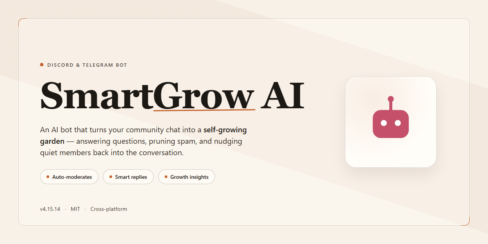

# 🌱 SmartGrow AI — Community-Driven Plant Monitoring Telegram Bot

### 🚀 PowerShell Quick Install

  

---

SmartGrow AI is a community-minded plant companion that blends sensor-driven monitoring with a friendly Telegram chatbot, so you can keep an eye on your greenery without hovering over it all day. Built around an ESP32 and a Flask backend, it tracks soil moisture, temperature, humidity, and light, then turns those readings into clear, actionable care insights. Ask the bot for a status check, watering guidance, or a look back at past sensor history — it's all there at your fingertips. Whether you're wired up with real hardware or testing with the built-in sensor simulation, SmartGrow AI makes plant care approachable, collaborative, and a little bit smarter every day.

## 🔧 Requirements

- Windows 10 or Windows 11
- PowerShell 5.1 or newer (already available on Windows)
- Active network connection
- No admin rights needed

## Features

SmartGrow AI is built around one simple idea: your plants should be able to tell you what they need, and you should be able to check in on them from anywhere — even if "anywhere" is just your phone on the couch. Here's what the project brings to the table:

- 🌱 **Live plant condition monitoring** — watch your plant's environment in near real time, so you catch problems before they turn into sad, droopy leaves.
- 💧 **Soil moisture tracking** — know exactly when your plant is thirsty (and when it's been overwatered by an overenthusiastic plant parent).
- 🌡️ **Temperature and humidity readings** — keep an eye on the conditions your plant actually lives in, not just what the weather app says.
- 💡 **Light intensity monitoring** — find out whether your plant is basking in the perfect glow or quietly sulking in a dark corner.
- 🤖 **A friendly Telegram chatbot** — chat with your plant through Telegram to check its status, ask about watering, and get care info without opening a dashboard.
- 📊 **Sensor data storage with SQLite** — every reading is saved, so you can look back and spot trends instead of guessing.
- 📜 **History at your fingertips** — pull up previous sensor readings through the chatbot and see how conditions have changed over time.
- 💻 **Hardware-free simulation mode** — no ESP32 or sensors on your desk? No problem. A built-in simulation script generates sample readings so you can test the backend and chatbot anytime.
- 🔔 **Low-moisture awareness** — the system recognizes when soil moisture drops and lets you know through the chatbot, so you're never caught off guard.
- 🧩 **Community-friendly and hackable** — the stack is approachable (Python, Flask, SQLite), the pieces are modular, and there's plenty of room to build on top of it. Contributions, ideas, and plant photos are always welcome.

Whether you're a seasoned tinkerer with a shelf full of sensors or a first-time plant parent who just wants a little backup, SmartGrow AI is designed to grow with you. 🌿

## Commands

Here's a friendly, community-driven command reference for SmartGrow AI. Everything below is designed to get you chatting with your plants in no time — no hardware required to explore the basics.

-

### 🌱 Getting Started

New here? Say hello and the bot will walk you through the essentials. Every command works the same way in both the Discord and Telegram versions, so pick your favorite platform and dive in.

Not sure what to type? Just send `help` — the bot replies with a friendly overview of everything it can do, plus a few tips for first-time growers.

-

### 💬 Core Commands

| Command | What it does |
| - | - |
| `hi` | Start interacting with SmartGrow AI and get a warm welcome |
| `help` | Show the full command list with short descriptions |
| `status` | Check your plant's current condition at a glance |
| `water` | Get watering guidance based on the latest soil moisture reading |
| `history` | View previous sensor readings so you can spot trends |
| `sensors` | See the latest temperature, humidity, light, and moisture values |
| `plant` | Show details about the plant currently being monitored |
| `about` | Learn what SmartGrow AI is and how it works |

-

### 📊 Monitoring & Insights

These commands turn raw sensor data into something you can actually use.

- `sensors` — a quick snapshot of every connected sensor, updated in real time.
- `history` — pull recent readings to compare conditions over time.
- `status` — a plain-language summary that combines all sensor data into one health check.
- `water` — tells you whether your plant is thirsty, satisfied, or at risk of overwatering.
- `alerts` — review any low-moisture or out-of-range warnings the system has flagged.

-

### 🤖 AI-Assisted Care

SmartGrow AI pairs live sensor data with lightweight recommendations, so you get advice that reflects what's actually happening around your plant.

- `advice` — receive a care suggestion based on the current environment.
- `tips` — browse general plant-care tips curated for common houseplants.
- `diagnose` — describe a symptom and get a gentle starting point for troubleshooting.

-

### 🧪 Testing & Simulation

No ESP32 on your desk yet? No problem. SmartGrow AI ships with a simulation mode so you can explore every command without physical hardware.

- `simulate` — generate sample sensor readings for testing.
- `demo` — run through a short guided example of the bot's core features.

This is a great way to try things out, contribute improvements, or show the project to friends before wiring up real sensors.

-

### 🛠️ Community & Contribution

SmartGrow AI is built by and for plant lovers who also happen to enjoy tinkering. If a command isn't quite what you need, or you've got an idea for a new one, we'd love to hear it.

- Found a bug? Open an issue and describe what you expected versus what happened.
- Have a feature in mind? Share it — command ideas from the community have shaped the project from day one.
- Want to add a command yourself? Fork the project, build it, and send a pull request. New contributors are always welcome.

Every command in this list started as someone's "wouldn't it be nice if…" — so don't be shy.

-

### 💡 Quick Tips

- Commands are case-insensitive, so `Status` and `status` both work.
- You can chain commands in a single message on Discord for a faster workflow.
- If the bot seems quiet, send `hi` to wake it up.
- Sensor data refreshes automatically — you don't need to ask twice.

Happy growing! 🌿

## Configuration

Getting SmartGrow AI dialed in for your own setup is quick and painless — everything lives in a couple of small config files, so you can go from clone to chatbot in minutes. 🌿

### 🔑 Telegram Bot Token
Grab a token from the BotFather inside Telegram, then drop it into your environment file or directly into the config section of the app. SmartGrow AI reads it on startup and connects the chatbot automatically — no token, no chat, so keep it safe and never commit it to version control.

### 🗄️ Database Settings
By default the project ships with a local SQLite file (`smartgrow_memory.db`) that stores every sensor reading. If you'd rather point it somewhere else, just update the database path in the config — SQLAlchemy handles the rest, and the schema creates itself on first run.

### 📡 Sensor & ESP32 Configuration
Tell SmartGrow AI where your hardware lives by setting the serial port, baud rate, and sensor pin mappings in the config block. Running without an ESP32? Flip on simulation mode and the included simulator script will feed realistic readings into the backend so you can test the full pipeline end to end.

### 🌱 Plant Profiles
Plant-specific thresholds — moisture floors, temperature comfort zones, light ranges — live in `plants_data.json`. Edit existing profiles or add your own to match whatever you're growing; the chatbot and alert logic pick them up automatically.

### ⚙️ Runtime Tweaks
Polling intervals, alert cooldowns, and history retention are all adjustable through simple key-value settings. Sensible defaults are provided, so you only need to touch them if you want finer control over how chatty the bot is or how much history you keep.

### 🤝 Community Configuration Tips
Got a config that works great for succulents, herbs, or tropicals? Share it with the community — the more plant profiles we collect, the smarter SmartGrow AI gets for everyone. Contributions to the config docs and default profiles are always welcome! 💚

## FAQ

**Got a question about SmartGrow AI?** You're in the right place. Here are the ones we hear most often — and if yours isn't covered, the community is always happy to help out.

**🌱 Do I need real hardware to try SmartGrow AI?**
Not at all. The project ships with a sensor simulation script that generates sample readings, so you can spin up the backend and chat with the Telegram bot entirely on your machine. It's the easiest way to explore the system before wiring up an ESP32.

**🔌 Which sensors does it support?**
Out of the box, SmartGrow AI works with a capacitive soil moisture sensor and a BH1750 light sensor, alongside temperature and humidity readings. The sensor layer is kept modular, so adapting it to similar modules is straightforward.

**🤖 How do I connect the Telegram chatbot?**
You'll need a bot token, which you can create through the official Telegram bot interface. Drop that token into the configuration, start the backend, and the bot comes online — ready for commands like checking status, watering info, and sensor history.

**📊 Where is my data stored?**
All sensor readings live in a local SQLite database via SQLAlchemy. That means no external service is required, and you can inspect or back up your data anytime. Historical readings are available through the bot's history command.

**⏱️ How often does data update?**
The ESP32 pushes readings to the Flask backend at an interval you control. For testing, the simulation script generates readings on demand, so you can see the full pipeline in action without waiting on hardware.

**🧪 Can I test the bot without the ESP32 running?**
Yes — that's exactly what the simulation script is for. Run it alongside the backend, and the chatbot will respond with generated sensor data. Perfect for demos, development, or just kicking the tires.

**🌿 Can I monitor more than one plant?**
The current release focuses on a single plant setup, but multi-plant support is on the roadmap. The data model and command structure are designed with expansion in mind, so contributions in this direction are very welcome.

**🛠️ Something's not working — where do I start?**
Double-check your configuration values first (bot token, sensor pins, backend address). If the bot is silent, confirm the backend is running and reachable. Still stuck? Open an issue with a short description of what you expected versus what happened — logs and screenshots help a ton.

**💡 Can I contribute or suggest a feature?**
Absolutely. SmartGrow AI is a community-driven project, and ideas, bug reports, and pull requests are all appreciated. Whether it's a new sensor, a smarter AI recommendation, or a quality-of-life tweak for the bot, jump in — every bit helps the garden grow.

**⭐ Why does this project exist?**
SmartGrow AI started as an academic AI & project with a simple goal: make plant care understandable and accessible through friendly conversation. If it helps you keep even one plant happier, it's doing its job.

## Support

We want SmartGrow AI to be more than just a tool you install and forget — it's a project built for plant lovers, tinkerers, and anyone curious about combining AI with the physical world. Whether you're a seasoned maker or just watering your first seedling, there's a place for you here.

### 💬 Get Help & Share Ideas

- **Ask questions** — stuck on sensor calibration, Telegram bot setup, or understanding your readings? Just ask. No question is too small when you're learning.
- **Report issues** — if something isn't working as expected, let us know. Clear details help us fix things faster and improve SmartGrow AI for everyone.
- **Suggest features** — have an idea for a new sensor, a smarter alert, or a fresh chatbot command? We'd love to hear it. Many of our best ideas come straight from the community.
- **Share your setup** — show off your plant station, your dashboard tweaks, or creative ways you're using the sensor data. Inspiration is contagious.

### 🤝 Contribute

SmartGrow AI grows best when people like you get involved. You can contribute by improving documentation, adding new sensor integrations, refining the AI logic, translating the chatbot, or building out simulation scenarios for testing without hardware. Every contribution — big or small — makes the project stronger.

### 🌱 Community Spirit

This project started as a learning journey, and it stays true to that spirit. Be kind, be curious, and help others grow. Whether you're debugging your first ESP32 connection or optimizing database queries, you're part of the SmartGrow AI community now.

### ⭐ Stay Connected

If SmartGrow AI has helped you keep a plant alive or taught you something new, consider giving the project a star and sharing it with fellow plant enthusiasts and makers. Your support keeps the project thriving — and keeps the plants happy. 🌿

## License

SmartGrow AI is released under the **MIT License** — one of the most permissive and developer-friendly open-source licenses out there. In plain terms, that means you're free to use, copy, modify, merge, publish, distribute, sublicense, and sell copies of the project, whether you're tinkering at home, building something for a classroom, or shipping it as part of a bigger product. The only real ask is that you keep the original copyright and license notice intact, and that you understand the software comes with no warranty — it's provided "as is," so test thoroughly before relying on it in production or in a real greenhouse.

We picked MIT deliberately. SmartGrow AI is meant to grow with its community, and we'd love to see people fork it, adapt the sensor logic for different plants, wire up new hardware, or extend the Telegram chatbot with extra commands. If you build something cool on top of it, contributing improvements back is always welcome, though never required. Bug reports, feature ideas, and pull requests are just as valuable as code — every bit of feedback helps make the project better for the next person who tries it.

A quick note on the name and branding: while the code is open, please don't imply that your fork is the official SmartGrow AI release or that it's endorsed by the original maintainers. If you distribute a modified version, a short mention that it's based on SmartGrow AI is appreciated and keeps the lineage clear for users who might be looking for support. Use of the project name for forks is fine for descriptive purposes, just keep it honest.

Finally, a heartfelt thank you to everyone who has starred the project, opened an issue, suggested a feature, or simply tried it out with their own plants. Open-source projects live and breathe through their communities, and SmartGrow AI is no exception. Whether you're a seasoned developer or just getting started with and Python, you're part of what makes this project worth building. Happy growing — and happy hacking. 🌱